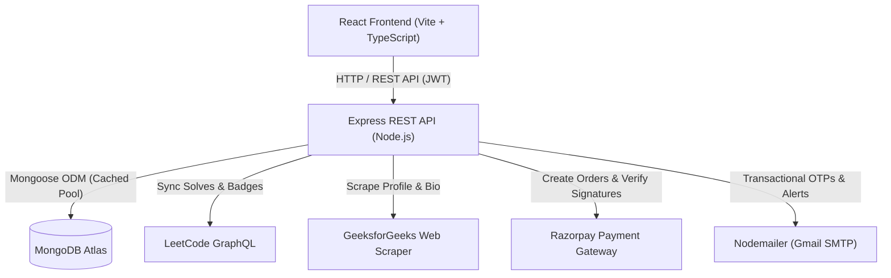

# ConsistPay

ConsistPay is a full-stack web application designed to help software engineers maintain long-term consistency in Data Structures and Algorithms (DSA). By pairing automated activity synchronization from competitive programming platforms with financial commitment contracts and peer-to-peer coding duels, the platform turns daily problem solving into an accountable habit.

- **Live Deployment:** [consistpay.tech](https://consistpay.tech)
- **Source Repository:** [github.com/vanshinatorr/ConsistPay](https://github.com/vanshinatorr/ConsistPay)

---

## Highlights

- **Automated Coding Activity Synchronization:** Direct integration with LeetCode (GraphQL API), GeeksforGeeks (profile scraping), and Code360. Solves are filtered, deduplicated, and mapped to calendar days in Indian Standard Time (IST).
- **Commitment Contracts & Daily Deposits:** Users select a daily commitment tier (₹5, ₹10, ₹20, or ₹50) and deposit funds for a 30-day cycle. Maintaining consistency preserves the deposit and unlocks bonus yields, while unexcused misses forfeit stakes.
- **Streak Protection with Grace Coins:** Consecutive milestones award Grace Coins that automatically protect active streaks from breaking during unavoidable missed days.
- **Peer-to-Peer 1v1 Consistency Battles:** Pro users can create or join timed competitive coding challenges (7-day or 14-day duels) with matched stakes, unique invite codes, side-by-side daily progress grids, and automated winner or tie settlement.
- **Dual Wallet System:** Clean architectural separation between consistency cycle deposits (`balance`) and PVP battle stakes (`battleBalance`), featuring atomic balance deductions and UPI withdrawal request processing.
- **Milestones & Global Leaderboards:** Automatic evaluation of milestone badges (streak lengths, total solved volume, consistency percentages) paired with dynamic leaderboards ranked by current streaks and commitment activity.

---

## Technical Architecture

The application is built as a decoupled full-stack architecture comprising a single-page React client, an Express REST API backend, and MongoDB Atlas for persistent storage.



### Folder Responsibilities

- **`Front-End/src/app/pages/`**: Primary page views including Dashboard, Battle Arena, Onboarding, Profile, Leaderboard, and Admin consoles.
- **`Front-End/src/app/components/`**: UI primitives, navigation layouts, modals, duel timeline visualizers, and achievement cards.
- **`back-end/src/controllers/`**: Core business logic for authentication, challenge settlements, payments, streak syncing, and administrative operations.
- **`back-end/src/providers/` & `services/`**: External platform integration clients responsible for fetching submissions and verifying account ownership tokens.
- **`back-end/src/models/`**: Mongoose schemas defining users, submissions, platform linkages, challenges, payments, and notifications.
- **`back-end/src/middleware/`**: Request pipeline guards handling JWT validation, role-based authorization, rate limiting, and database connection readiness.

---

## Technology Stack

### Frontend
- **Framework & Build:** React 18, Vite 6, TypeScript
- **Styling & Layout:** TailwindCSS v4, Emotion, Motion
- **Component Primitives:** Radix UI, Material UI Icons, Lucide React
- **Data Display & Alerts:** Recharts, Date-fns, Sonner, React Hot Toast, Canvas Confetti

### Backend
- **Runtime & Server:** Node.js, Express 5
- **Database & Modeling:** MongoDB, Mongoose 9
- **Authentication & Security:** JSON Web Tokens (`jsonwebtoken`), `bcryptjs`, `crypto.timingSafeEqual`

### External Integrations & Tooling
- **Payments:** Razorpay Node SDK (Order creation, webhook signature verification)
- **External Platforms:** LeetCode GraphQL API, Cheerio/Fetch-based GeeksforGeeks profile scraper, Code360
- **Email Delivery:** Nodemailer (SMTP transport)
- **AI Verification:** Google Generative AI (Gemini SDK)

---

## Key Application Flows

### 1. Platform Profile Linking & Verification
1. The user selects a supported platform (LeetCode, GeeksforGeeks, or Code360) and inputs their public handle.
2. The backend generates a secure verification token (e.g., `cp_verify_xxxxxx`) and saves a pending linkage record.
3. The user pastes this token into their external platform biography or summary.
4. When the user requests verification, the backend queries or scrapes the public profile page to confirm the presence of the token, preventing unauthorized account claiming.

### 2. Daily Solve Synchronization & Streak Computation
1. Either manually through the dashboard or during automated background sweeps, the sync handler queries connected platform profiles for recent submissions.
2. Solves are filtered to completed problems, converted into ISO calendar dates (`YYYY-MM-DD`) in Indian Standard Time (`Asia/Kolkata`), and deduplicated against existing database records.
3. The user's streak helper evaluates whether yesterday and today contain valid solves, updating current and maximum streak counters and allocating Grace Coins where milestone criteria are met.

### 3. Peer-to-Peer 1v1 Battle Lifecycle
1. A Pro user initiates a challenge specifying duration (e.g., 7 days) and stake (₹100–₹1,000). The stake plus an entry fee are atomically deducted from their battle wallet (`battleBalance`).
2. A unique alphanumeric invite code (`CP-XXXXXX`) is generated.
3. An opponent enters the invite code, validates the terms, and pays the matching total cost via atomic balance deduction. The battle status transitions to `active` with an explicit IST end-of-day boundary.
4. Once the battle end timestamp passes, a lazy evaluation hook syncs both players' platforms, aggregates unique solve days across the contest period, awards double the stake to the winner, or refunds stakes in the event of a tie.

---

## Project Structure

```
ConsistPay/
├── Front-End/
│   ├── src/
│   │   ├── app/
│   │   │   ├── components/      # Shared UI widgets, dialogs, and navigation
│   │   │   ├── pages/           # Application views (Dashboard, Battles, Leaderboard)
│   │   │   └── routes.ts        # Client-side route declarations
│   │   ├── styles/              # Global styles and Tailwind entry points
│   │   └── main.tsx             # React DOM entry point
│   ├── .env.example             # Frontend environment variables template
│   ├── package.json             # Frontend dependencies and Vite configuration
│   └── vite.config.ts           # Vite bundler plugins and settings
├── back-end/
│   ├── src/
│   │   ├── config/              # MongoDB connection caching setup
│   │   ├── controllers/         # Request handling and domain logic
│   │   ├── middleware/          # Auth, rate limiting, and DB connection middleware
│   │   ├── models/              # Mongoose data models
│   │   ├── providers/           # Platform scraping and GraphQL scrapers
│   │   ├── routes/              # Express API route modules
│   │   ├── services/            # Platform aggregation services
│   │   ├── utils/               # Streak calculations, email helpers, and badges
│   │   ├── app.js               # Express application initialization and middleware
│   │   └── server.js            # Server entry point and process lifecycle guards
│   ├── .env.example             # Backend environment variables template
│   └── package.json             # Backend dependencies and runner scripts
├── PRODUCTION_READINESS.md      # Deployment guidelines and SRE documentation
└── README.md                    # Project documentation
```

---

## Local Setup

### Prerequisites
- **Node.js**: v18.x or later
- **npm**: v9.x or later
- **MongoDB**: A running local instance or a free MongoDB Atlas cluster connection URI

### 1. Clone the Repository
```bash
git clone https://github.com/vanshinatorr/ConsistPay.git
cd ConsistPay
```

### 2. Configure Backend Environment
Navigate to the `back-end` directory and initialize the environment file:
```bash
cd back-end
cp .env.example .env
```

Populate the newly created `back-end/.env` file with appropriate values:
```env
PORT=5000
MONGO_URI=mongodb+srv://<username>:<password>@cluster.mongodb.net/consistpay
JWT_SECRET=your_jwt_secret_key_here
GEMINI_API_KEY=your_gemini_api_key_here
RAZORPAY_KEY_ID=your_razorpay_key_id
RAZORPAY_KEY_SECRET=your_razorpay_key_secret
EMAIL_USER=your_email@gmail.com
EMAIL_PASS=your_gmail_app_password
ENABLE_AUTOMATED_EMAILS=false
```

### 3. Install Backend Dependencies & Start Server
```bash
npm install
npm run dev
```
The API server will launch at `http://localhost:5000` with hot-reloading via `nodemon`.

### 4. Configure Frontend Environment
In a new terminal window, navigate to the `Front-End` directory:
```bash
cd ../Front-End
cp .env.example .env
```

Populate the `Front-End/.env` file:
```env
VITE_API_URL=http://localhost:5000
VITE_RAZORPAY_KEY=your_razorpay_key_id
VITE_GOOGLE_CLIENT_ID=your_google_client_id
```

### 5. Install Frontend Dependencies & Start Client
```bash
npm install
npm run dev
```
The Vite development server will start at `http://localhost:5173`. Open this URL in your browser to interact with the application.

---

## Implementation Notes

- **Serverless Connection Management:** In environments such as Vercel Serverless, database connections are cached globally (`cachedConnection`) and command buffering is disabled (`bufferCommands: false`). The custom `dbMiddleware` ensures that `mongoose.connection.readyState === 1` before controllers execute database queries.
- **Standardized Timezone Handling:** Problem submission evaluations and battle timeline days are explicitly normalized to Indian Standard Time (`Asia/Kolkata`) using the `en-CA` locale format (`YYYY-MM-DD`), preventing timezone shifts across international clients.
- **Protection for Rate-Limited Services:** Zero-dependency in-memory rate limiting guards resource-intensive endpoints (`/api/auth/send-otp` and `/api/platforms/sync`) against bot abuse and third-party quota exhaustion.
- **Operations & SRE Guidelines:** For deployment operational runbooks, Vercel/Render hosting notes, and troubleshooting steps, refer to [PRODUCTION_READINESS.md](PRODUCTION_READINESS.md).
